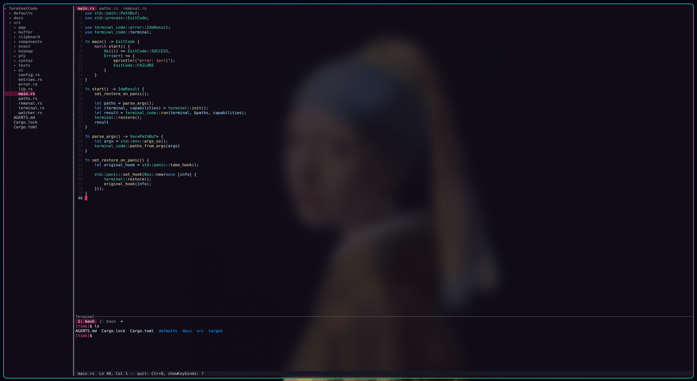

# TerminalCode

A lightweight, keyboard-driven IDE for the terminal, built with Rust and [Ratatui](https://ratatui.rs).



*The background picture comes from the terminal emulator, not from TerminalCode.*

## Status

**This is version 0.5.0.** The command is `trcode` (it was `terminal_code` before 0.2.1). Release builds for Linux and Windows (and macOS, best effort) are on the
[releases page](https://github.com/Tim-kieboom/TerminalCode/releases) with their checksums, or you can build from
source (see below). What is planned next is tracked in [docs/todo.md](docs/todo.md); the design is in
[docs/design.md](docs/design.md).

**Windows has been built and tested in CI only; nobody has tried it by hand in Windows Terminal yet.** The terminal
pane, key encoding, resize, paste and mouse reports there are the likeliest places for surprises. Please report what
you find. The Linux build is what the author uses, and the Linux release binary is built on a current Ubuntu, so it
needs a recent glibc; on an older system build from source.

## What it does

- **Editor:** tabs, split panes, undo and redo, smart indent, find and replace in a file, go to line, and the mouse
  (click, drag, double and triple click, the wheel, a right click menu, and a right click menu on a tab: close, close others, to the left or the right, close all, pin; a pinned tab stays at the left and is left alone by the close-many items). Files are UTF-8.
- **Syntax colors** for Rust, TOML, JSON, Markdown and Nix, computed on a background thread so typing never waits.
- **Explorer:** a project tree that shows what `.gitignore` leaves out dimmed (you can still open it), with create, rename, move (also by drag and drop) and delete.
- **Finder and project search:** open a file by name from anywhere (`ctrl+p`), and search the whole project (`alt+f`).
- **Integrated terminal:** a shell in a pane, with tabs, scrollback and mouse reporting, on Linux, macOS and Windows.
- **Command palette** (`f1`) for every action.
- **Everything is a file you can edit:** settings, key bindings, the layout and the themes are plain text files that
  are applied when you save them, with no restart.
- **Safe with your files:** a file changed on disk under your edits is never overwritten without asking, a deleted
  file stays open with a `[deleted]` note, and a read-only file is locked against edits. On Linux, `File: Edit Anyway (save as root)` in the palette unlocks such a file, and saving it (or saving a file in a folder you may not write to) asks for your password and has `sudo` write it: the password is never kept, every such save asks again.

## Build and run

You need a recent stable Rust toolchain (the project uses the 2024 edition).

```bash
cargo build --release
./target/release/trcode [folder] [file ...]
```

The first folder you name is the project; the files are opened in tabs. With no arguments it opens the current
folder. `trcode -v` prints the version and `trcode -h` the usage (a file named like a flag opens with `--` before it).
The binary is `trcode.exe` on Windows.

Any terminal with true color works. A terminal that supports the
[kitty keyboard protocol](https://sw.kovidgoyal.net/kitty/keyboard-protocol/) (kitty and foot, for example)
reports every key combination; others get fallbacks for the combinations they lose.

### Nix and NixOS

The repository is a flake. Try it without installing, or install it into your profile:

```bash
nix run github:Tim-kieboom/TerminalCode -- [folder] [file ...]
nix profile install github:Tim-kieboom/TerminalCode
```

On NixOS, add it as an input and put `inputs.terminal_code.packages.${pkgs.stdenv.hostPlatform.system}.default` in
`environment.systemPackages`. On Linux the package puts `wl-clipboard` and `xclip` on the program's `PATH` for the
clipboard; `rust-analyzer` is not included, install it yourself for the language server. `nix develop` gives a shell
with the Rust toolchain to work on the code.

## Keys

Press `f1` for the command palette, which lists every action with its key. The defaults:

| Keys | Action |
|---|---|
| `ctrl+q` | Quit (asks first when something is unsaved) |
| `ctrl+s` / `ctrl+k a` | Save / save all |
| `ctrl+z`, `ctrl+y` | Undo, redo |
| `ctrl+c`, `ctrl+x`, `ctrl+v` | Copy, cut, paste (also `ctrl+insert`, `shift+delete`, `shift+insert`) |
| `ctrl+a` | Select all |
| `tab`, `shift+tab` | Indent, outdent (a selection over several lines indents each line) |
| arrows, `home`, `end`, `ctrl+home`, `ctrl+end` | Move; add `shift` to select |
| `alt+up`, `alt+down` | Move the line (or the selected lines) up or down |
| `ctrl+up`, `ctrl+down` | Move to the previous or next blank line (a line of only spaces counts as blank); add `shift` to select up to it |
| `ctrl+alt+up`, `ctrl+alt+down` | Add a cursor on the line above or below (typing, deleting, moving and selecting then act on every cursor; `alt+click` adds one at the pointer, `alt+drag` a selection; `esc` or a plain click goes back to one cursor; copy, paste and indent use the main cursor only) |
| `ctrl+f`, `ctrl+r` | Find in the file, replace |
| `ctrl+g` | Go to line (`line` or `line:column`) |
| `ctrl+p` | Find a file by name (`name:42` opens it at line 42; `alt+enter` opens it beside this pane) |
| `alt+f` | Search the project; `f4` and `shift+f4` step through the results |
| `f8`, `shift+f8` | Go to the next, previous diagnostic (errors and warnings a language server found, written after the code of their line and underlined) |
| `f12`, `ctrl+click` | Go to where the word at the cursor (or under the pointer, for `ctrl+click`) is defined, opening the file when it is not open; a file outside the project (the source of the standard library) opens read-only and stays with the same language server; `alt+,` goes back |
| `f6` | What the language server says about the word at the cursor (its type, signature and documentation) in a box under it. The same box comes up by itself when the mouse pointer rests on a word for about half a second and goes when the pointer moves on; `f6` with that box up keeps it until a key (the arrow and page keys scroll it, `esc` or `f6` closes it, any other key closes it and does its work). The wheel over the box scrolls it |
| `f7` | The whole text of the diagnostics on the cursor's line in a box (for a message that is cut after the code; arrows and page keys scroll, any other key closes) |
| `tab`, `up`, `down`, `esc` | While the box of suggestions is open (it appears as you type, from a language server): `tab` writes the highlighted one (a call with its brackets and the first argument selected, and the `use` line it needs, as one undo step), `up` and `down` move the highlight, `esc` closes the box; `enter` closes it and is a newline; a small box above shows the documentation of the highlighted one (`pgup` and `pgdn`, or the wheel over it, scroll it when it is longer) |
| `alt+,`, `alt+.` | Back to where the last jump left, and forward again (the places are recorded by go to line, a search or finder hit, `f8`, another file coming to the front and a mouse click more than a screen away; plain movement, typing and paging record nothing; the list keeps 100 places and moves them with your edits) |
| `ctrl+n`, `ctrl+w` | New file, close tab |
| `ctrl+tab`, `ctrl+shift+tab` | Next, previous tab |
| `ctrl+k e`, `ctrl+k w`, `ctrl+k z` | Close other tabs, close all tabs, reopen the closed tab |
| `ctrl+k right`, `ctrl+k down` | Split the pane |
| `alt+h`, `alt+j`, `alt+k`, `alt+l` | Move to the pane on the left, below, above, on the right |
| `ctrl+b` | Move to the explorer (inside the explorer: `a` new file, `shift+a` new folder, `r` or `f2` rename, `m` move, `delete`, `.` show or hide dotfiles, `f5` refresh) |
| `ctrl+k b`, `ctrl+k s` | Show or hide the explorer, the status bar |
| `` ctrl+` `` | Show, focus or hide the terminal |
| `alt+m` | Mouse on or off for this run (off lets the terminal select text) |

Inside the terminal pane every key goes to the shell except `ctrl+b`, which starts a short chord: `ctrl+b e`
returns to the editor, `ctrl+b x` to the explorer, `ctrl+b t` hides the pane, `ctrl+b c` opens a new terminal tab,
`ctrl+b n` and `ctrl+b p` step through the tabs, `ctrl+b 1` to `9` pick one, `ctrl+b w` closes it, and
`ctrl+b ctrl+b` sends a real `ctrl+b` to the shell. `shift+page up` and `shift+page down` scroll its history.

## Configuration

The files live in the `terminalcode` folder of your config directory (`~/.config/terminalcode` on Linux,
`~/Library/Application Support/terminalcode` on macOS, `%APPDATA%\terminalcode` on Windows). Every one is optional,
and TerminalCode applies a file as soon as you save it. From the command palette, `Config: Open Settings`, `Open
Keymap`, `Open Layout` and `Open Theme` open the file, making it from the built-in default first when it is missing.
`Config: Reset Settings to Default` (and the same for the keymap, layout and theme) asks first, keeps the file you have as
`NAME.bak` (an older backup is replaced) and puts the built-in default in its place; `Config: Forget Hidden and Shown Panes`
does the same for `state.json`.

- **`settings.json`** (comments and trailing commas are allowed). A setting you leave out keeps its default.

  | Setting | Default | Meaning |
  |---|---|---|
  | `theme` | `null` | The name of a file in `themes/` (without `.toml`). `null` is the built-in fallback theme, which is not listed as a theme to choose |
  | `shell` | `null` | The program the terminal runs; `null` is your own shell. Applies to new terminal tabs |
  | `mouse` | `true` | Whether the mouse is on at the start |
  | `tab_size` | `4` | Columns a tab character draws (1 to 16) and columns of one level of space indentation |
  | `indent_style` | `"spaces"` | What the Tab key inserts: `"spaces"` or `"tabs"` |
  | `detect_indent` | `true` | A file that already has indentation keeps its own; the two settings above are for files with none |
  | `sequence_timeout` | `1000` | Milliseconds (200 to 5000) a half-typed key sequence such as `ctrl+k ctrl+i` waits for its next key; then it is dropped, and the status bar shows the keys while it waits. `0` waits for ever |
  | `notification_seconds` | `4` | Seconds (1 to 60) a plain message stays on screen. Errors stay until you press a key or click |
  | `hide_ignored` | `false` | `true` leaves the entries your ignore rules skip (`target/`, `node_modules/`) out of the explorer instead of listing them dimmed. The file finder and project search never list them |
  | `language_servers` | Rust through `rust-analyzer` | Language servers by name: `command`, `args`, `extensions`, `root_files`, raw `initialization_options` and `language_ids` (what the server is told a file is, by file name: `{ "settings.json": "jsonc" }`; see below). An entry with a built-in name replaces it, `null` turns it off. Needs the server installed |

  `language_ids` is for JSON files that allow comments: a JSON language server flags comments and trailing commas in a file it is
  told is `json`. Files that are known to allow them are sent as `jsonc` already (`settings.json` in the config folder,
  `.vscode/*.json`, `tsconfig*.json`, `jsconfig.json`, `devcontainer.json`); an entry of `language_ids` goes by the bare file
  name, so `"settings.json"` matches every file with that name, and it wins over the built-in names. A change restarts the
  servers.

  A mistake in the file (wrong type, a value out of range) is reported as a notification that names the setting,
  and the settings you had stay in force.
- **`keymap.toml`** adds to or removes from the default key bindings.
  [defaults/default_keymap.toml](defaults/default_keymap.toml) lists every action and key name.
- **`layout.ron`** says which panes there are and how they are arranged: see
  [defaults/default_layout.ron](defaults/default_layout.ron).
  A pane can say `hidden: true` to start hidden. What you hide or show while working is remembered in `state.json` in the same
  folder, written at every change, and wins over the layout at the next start; delete that file to go back to the layout.
- **`themes/NAME.toml`** is a theme: a palette of colors and the style of every part of the screen. Choose one with
  `"theme": "NAME"`. The built-in Dark, Light, SolDark and SolLight are only templates: `Theme: New...` in the palette
  makes a theme from one, names it, chooses it and opens it. A built-in theme still stands behind every theme file and
  is the fallback when `theme` is `null`; an old `"theme": "dark"` with no `themes/dark.toml` gives one warning and the fallback.
  A pane can have its own background colour: `[background.editor]`, `explorer`, `terminal`, `statusbar` and `popup` (every
  box) take the same keys as `[background]`, and a key left out is the screen's, so a darker terminal pane is
  `[background.terminal]` with `color = "#181818"`.

## Known limits

- A single line of plain ASCII (a minified bundle, a one-line JSON dump) is fine up to 10 MB (about 13 ms per key). A
  single line with other characters in it (accents, CJK, emoji, a tab) is walked character by character and gets slower
  than 50 ms at about 500 KB (100 ms at 1 MB). Files made of many ordinary lines are fine: 10 MB opens in about 10 ms.
- Only UTF-8 files can be opened.
- Undo is linear (no undo tree), and cursors beyond the first only take part in typing, deleting and moving.
- A language server client is built in (Rust through `rust-analyzer`, set up in `settings.json` under `language_servers`); it shows diagnostics, suggestions as you type (with brackets and documentation) and what the server says about the word under the pointer or the cursor (hover), with no go to definition yet. No debugger or plugins yet; those are planned after 0.3.0 (see the backlog in
  [docs/todo.md](docs/todo.md)).
- The vim layer is planned for after 0.3.0 too; the editor works like an IDE until then.
- On macOS the terminal pane's timing tests are flaky in CI, and the manual test pass on Windows Terminal is still
  to be done.

## License

Licensed under either of

- [Apache License, Version 2.0](LICENSE-APACHE)
- [MIT license](LICENSE-MIT)

at your option.

Unless you explicitly state otherwise, any contribution intentionally submitted for inclusion in this project by you,
as defined in the Apache-2.0 license, shall be dual licensed as above, without any additional terms or conditions.
