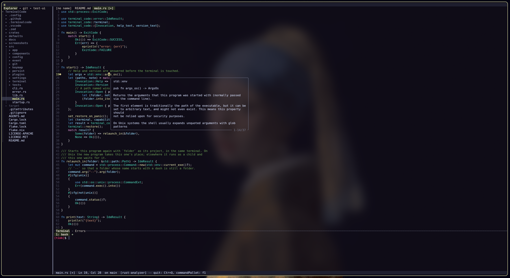
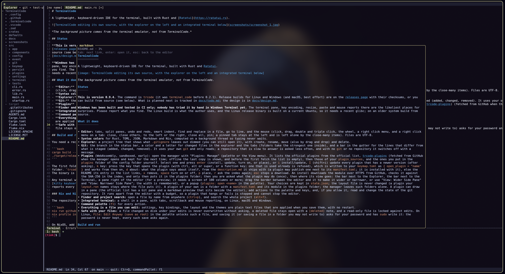
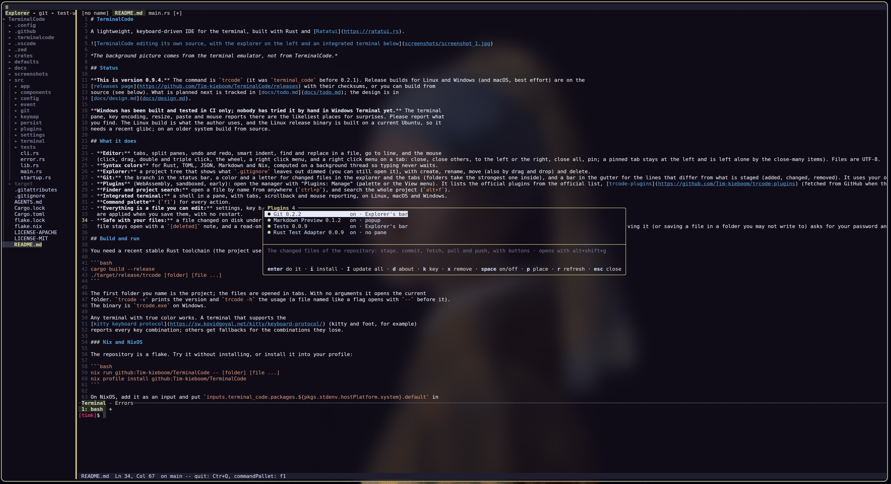
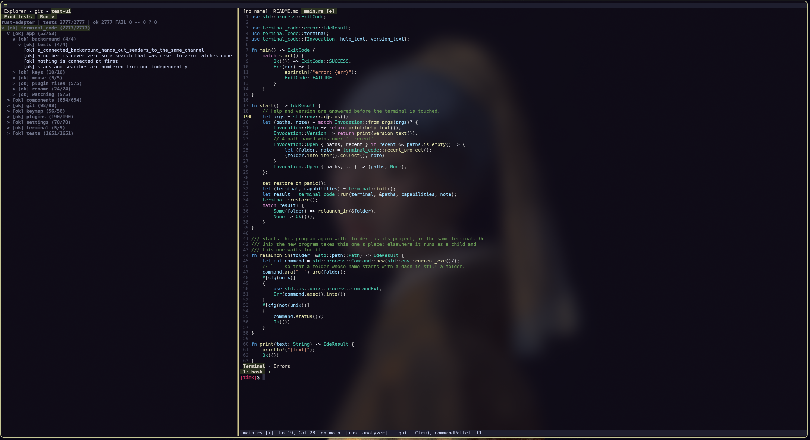

# TerminalCode

A lightweight, keyboard-driven IDE for the terminal, built with Rust and [Ratatui](https://ratatui.rs).



*The background picture comes from the terminal emulator, not from TerminalCode.*

| | |
|---|---|
|  |  |
| *The markdown viewer* | *The plugin manager* |
|  | |
| *The test UI* | |

## Status

**This is version 0.9.5.** The command is `trcode` (it was `terminal_code` before 0.2.1). Release builds for Linux and Windows (and macOS, best effort) are on the
[releases page](https://github.com/Tim-kieboom/TerminalCode/releases) with their checksums, or you can build from
source (see below). What is planned next is tracked in [docs/todo.md](docs/todo.md); the design is in
[docs/design.md](docs/design.md).

**Windows has been built and tested in CI only; nobody has tried it by hand in Windows Terminal yet.** The terminal
pane, key encoding, resize, paste and mouse reports there are the likeliest places for surprises. Please report what
you find. The Linux build is what the author uses, and the Linux release binary is built on a current Ubuntu, so it
needs a recent glibc; on an older system build from source.

## What it does

- **Editor:** tabs, split panes, undo and redo, smart indent, find and replace in a file, go to line, and the mouse
  (click, drag, double and triple click, the wheel, a right click menu, and a right click menu on a tab: close, close others, to the left or the right, close all, pin; a pinned tab stays at the left and is left alone by the close-many items). Files are UTF-8.
- **Syntax colors** for Rust, TOML, JSON, Markdown and Nix, computed on a background thread so typing never waits.
- **Explorer:** a project tree that shows what `.gitignore` leaves out dimmed (you can still open it), with create, rename, move (also by drag and drop) and delete.
- **Git:** the branch in the status bar, a color and a letter for changed files in the explorer and the tabs (folders take the strongest one inside), and a bar in the gutter for the lines that differ from what is staged (added, changed, removed). It uses your own `git` and only reads; a repository that is slow to answer is asked less often, and with no `git` or no repository it switches off with a message.
- **Plugins** (WebAssembly, sandboxed, early): open the manager with "Plugins: Manage" (palette or the View menu). It lists the official plugins from the official list, [trcode-plugins](https://github.com/Tim-kieboom/trcode-plugins) (fetched from GitHub when the manager opens and kept for the next time; offline the last copy is shown, and before the first fetch the list is empty), then those of your `plugin_sources`, and the ones you put in the `plugins` folder of the config folder yourself. Select one and press `enter` (install, update, turn on, or place), or `i` install/update, `I` (shift+i) update every plugin that has a newer version (after asking), `k` key: press the key that opens the plugin (with ctrl, alt or super, or a function key; one that is used already is refused), which is written to your `keymap.toml` as `{ open_plugin = "name" }` and works from then on, `d` about: what the plugin says about itself, from the `description.md` it ships with (a plugin may publish one next to its `manifest.toml`; it is installed with it), else the README its entry in the list links, `x` remove, `space` turn on or off, `p` place, `r` ask the index again; `esc` stops a download. An install downloads the module over HTTPS from GitHub, checks it against the SHA-256 in the index, and only then puts it in the plugins folder; then you are asked what the plugin may do (once), then where its view goes: the bar next to the Explorer, the bar next to the Terminal, a pane right of the editor (for a preview; it needs a screen of 100 columns or more; drag the border between the editor and it to make it wider or narrower, or use "View: Wider Side Pane" and "View: Narrower Side Pane"; the width is remembered), or a popup (`plugins: open <name>` in the palette). Your choices are kept in `state.json`; the layout file is never changed (a plugin your `layout.ron` names stays where the file puts it). A plugin of your own is a folder with a `manifest.toml` and its module in the plugins folder; the manager leaves such folders alone. A plugin can draw in a pane (the official list has a Git pane and a markdown preview that sits beside the editor), add actions to the palette and keys, and, if you allow it, read and change the state of the git repository. It runs apart from the editor with a budget, so a plugin that hangs or fails is stopped and cannot stop the editor.
- **Finder and project search:** open a file by name from anywhere (`ctrl+p`), and search the whole project (`alt+f`).
- **Integrated terminal:** a shell in a pane, with tabs, scrollback and mouse reporting, on Linux, macOS and Windows.
- **Command palette** (`f1`) for every action.
- **Everything is a file you can edit:** settings, key bindings, the layout and the themes are plain text files that
  are applied when you save them, with no restart.
- **Safe with your files:** a file changed on disk under your edits is never overwritten without asking, a deleted
  file stays open with a `[deleted]` note, and a read-only file is locked against edits. On Linux, `File: Edit Anyway (save as root)` in the palette unlocks such a file, and saving it (or saving a file in a folder you may not write to) asks for your password and has `sudo` write it: the password is never kept, every such save asks again.

## Build and run

You need a recent stable Rust toolchain (the project uses the 2024 edition).

```bash
cargo build --release
./target/release/trcode [folder] [file ...]
```

The first folder you name is the project; the files are opened in tabs. With no arguments it opens the current
folder. `trcode -v` prints the version and `trcode -h` the usage (a file named like a flag opens with `--` before it).
The binary is `trcode.exe` on Windows.

Any terminal with true color works. A terminal that supports the
[kitty keyboard protocol](https://sw.kovidgoyal.net/kitty/keyboard-protocol/) (kitty and foot, for example)
reports every key combination; others get fallbacks for the combinations they lose.

### Nix and NixOS

The repository is a flake. Try it without installing, or install it into your profile:

```bash
nix run github:Tim-kieboom/TerminalCode -- [folder] [file ...]
nix profile install github:Tim-kieboom/TerminalCode
```

On NixOS, add it as an input and put `inputs.terminal_code.packages.${pkgs.stdenv.hostPlatform.system}.default` in
`environment.systemPackages`. On Linux the package puts `wl-clipboard` and `xclip` on the program's `PATH` for the
clipboard; `rust-analyzer` is not included, install it yourself for the language server. `nix develop` gives a shell
with the Rust toolchain to work on the code.

## Keys

Press `f1` for the command palette, which lists every action with its key. The defaults:

| Keys | Action |
|---|---|
| `ctrl+q` | Quit (asks first when something is unsaved) |
| `ctrl+s` / `ctrl+k a` | Save / save all |
| `f5` | Run: save all, build the active binary or example (or a command of `.trcode/launch.toml`) and start it in its terminal tab; in the explorer `f5` refreshes the tree |
| `f9` | Set a breakpoint on the line of the cursor or take it away (a click on the last column of the gutter does the same); they are remembered for the project |
| `ctrl+k r` | Choose which binary, example or command `f5` runs (and run it); it is remembered for the project and shown in the status bar |
| `ctrl+k g` | Debug: build and start the active binary or example under `lldb-dap` (or the adapter named by `TRCODE_DEBUG_ADAPTER`), stopping at the breakpoints; `f5` goes on while a session runs |
| `f10`, `f11`, `shift+f11`, `shift+f5` | Debug, as in VS Code: step over, step into, step out, stop (`f10` opens the main menu while no program is stopped) |
| `ctrl+k n`, `ctrl+k i`, `ctrl+k u`, `ctrl+k x` | Debug: step over, step into, step out, stop |
| `ctrl+k v` | Show or hide the Debug pane (call stack and variables; in it: arrows, `enter`, `right` and `left` to open or close, `tab` between the two lists, `esc` to leave) |
| `ctrl+z`, `ctrl+y` | Undo, redo |
| `ctrl+c`, `ctrl+x`, `ctrl+v` | Copy, cut, paste (also `ctrl+insert`, `shift+delete`, `shift+insert`) |
| `ctrl+a` | Select all |
| `tab`, `shift+tab` | Indent, outdent (a selection over several lines indents each line) |
| `ctrl+/` | Toggle line comment on the cursor line, every selected line or each cursor's line: `//` for Rust and JSON, `#` for TOML and Nix, `<!-- -->` for Markdown (`ctrl+7` on a terminal without the kitty keyboard protocol) |
| `ctrl+]`, `ctrl+[` | Move the whole line (every selected line, each cursor's line once) one level in or out, with the cursor staying on its text. Without the kitty keyboard protocol `ctrl+[` is the escape key, so there `ctrl+]` (also `alt+]`) indents and `alt+\` outdents |
| arrows, `home`, `end`, `ctrl+home`, `ctrl+end` | Move; add `shift` to select |
| `ctrl+o` | Open a file by its path (relative to the project, absolute, or from `~`); "File: Open Folder..." in the menu or the palette asks for a folder and starts the editor again in it (the open tabs are closed; unsaved ones are asked about first) |
| `f10` | Open the main menu (the `≡` icon in the top row opens it too): File (new, open a file or a folder, open recent, save), View, Settings and Quit, each group opens a menu to its right with the keys its items have; `esc` closes it and the keyboard stays where it was |
| `ctrl+k d` | Show the list of problems the language servers report (errors first), in the bottom bar next to the terminal; `enter` or a click opens one (`ctrl+click` also goes to where the word there is defined), `esc` goes back to the editor |
| `alt+up`, `alt+down` | Move the line (or the selected lines) up or down |
| `ctrl+up`, `ctrl+down` | Move to the previous or next blank line (a line of only spaces counts as blank); add `shift` to select up to it |
| `ctrl+alt+up`, `ctrl+alt+down` | Add a cursor on the line above or below (typing, deleting, moving and selecting then act on every cursor; `alt+click` adds one at the pointer, `alt+drag` a selection; `esc` or a plain click goes back to one cursor; copy, paste and indent use the main cursor only) |
| `ctrl+f`, `ctrl+r` | Find in the file, replace: every match is highlighted and the current one selected. The bar stays open while you use the editor (a click in the text, or moving on with the keys, takes the keys back from it): the matches stay highlighted and follow what you type, `f3` and `shift+f3` go to the next and previous match from the cursor wherever you moved it, `ctrl+f` brings the keys back to the bar, `esc` closes it. In the bar: `enter`/`down` next, `shift+enter`/`up` previous, `alt+c`, `alt+w`, `alt+r` case, whole word and regex |
| `ctrl+g` | Go to line (`line` or `line:column`) |
| `ctrl+p` | Find a file by name (`name:42` opens it at line 42; `alt+enter` opens it beside this pane) |
| `alt+f` | Search the project; `f4` and `shift+f4` step through the results |
| `f8`, `shift+f8` | Go to the next, previous diagnostic (errors and warnings a language server found, written after the code of their line and underlined) |
| `f12`, `ctrl+click` | Go to where the word at the cursor (or under the pointer, for `ctrl+click`) is defined, opening the file when it is not open; a file outside the project (the source of the standard library) opens read-only and stays with the same language server; `alt+,` goes back |
| `f2` | Rename the symbol at the cursor everywhere it is used (a language server finds the places): a prompt takes the new name; files that are not open are written, open ones get the edit as one undo step and stay unsaved; nothing changes if any file does not fit the server's answer, a file is outside the project, or the server asks to move a file |
| `ctrl+.` (`alt+enter` where the terminal cannot tell `ctrl+.` apart) | What the language server offers to do at the cursor or the selection (a quick fix for a problem there, such as importing a missing name, or a refactoring), in a box: `enter` or a number picks one. The edit is made in the open files as one undo step each and left unsaved; a file the edit names that is not open is opened in a tab first |
| `alt+shift+f` | Format the open document with its language server (palette: "Language: Format Document"), without saving; "Language: Format Selection" formats the lines of the selection. See `format_on_save` under `language_servers` to format when saving |
| `f6` | What the language server says about the word at the cursor (its type, signature and documentation), with any problem it reports for that spot shown first, in a box under it. The same box comes up by itself when the mouse pointer rests on a word for about half a second and goes when the pointer moves on; `f6` with that box up keeps it until a key (the arrow and page keys scroll it, `esc` or `f6` closes it, any other key closes it and does its work). The wheel over the box scrolls it |
| `f7` | The whole text of the diagnostics on the cursor's line in a box (for a message that is cut after the code; arrows and page keys scroll, any other key closes) |
| `tab`, `up`, `down`, `esc` | While the box of suggestions is open (it appears as you type, from a language server): `tab` writes the highlighted one (a call with its brackets and the first argument selected, and the `use` line it needs, as one undo step), `up` and `down` move the highlight, `esc` closes the box; `enter` closes it and is a newline; a small box above shows the documentation of the highlighted one (`pgup` and `pgdn`, or the wheel over it, scroll it when it is longer) |
| `alt+,`, `alt+.` | Back to where the last jump left, and forward again (the places are recorded by go to line, a search or finder hit, `f8`, another file coming to the front and a mouse click more than a screen away; plain movement, typing and paging record nothing; the list keeps 100 places and moves them with your edits) |
| `ctrl+n`, `ctrl+w` | New file, close tab |
| `ctrl+tab`, `ctrl+shift+tab` | Next, previous tab |
| `ctrl+k e`, `ctrl+k w`, `ctrl+k z` | Close other tabs, close all tabs, reopen the closed tab |
| `ctrl+k right`, `ctrl+k down` | Split the pane |
| `alt+h`, `alt+j`, `alt+k`, `alt+l` | Move to the pane on the left, below, above, on the right |
| `ctrl+b` | Move to the explorer (inside the explorer: `a` new file, `shift+a` new folder, `r` or `f2` rename, `m` move, `delete`, `.` show or hide dotfiles, `f5` refresh) |
| `ctrl+k b`, `ctrl+k s`, `ctrl+k p` | Show or hide the explorer, the status bar, the side pane (the pane right of the editor: a plugin's preview) |
| `` ctrl+` `` | Show, focus or hide the terminal |
| `alt+m` | Mouse on or off for this run (off lets the terminal select text) |

Inside the terminal pane every key goes to the shell except `ctrl+b`, which starts a short chord: `ctrl+b e`
returns to the editor, `ctrl+b x` to the explorer, `ctrl+b t` hides the pane, `ctrl+b c` opens a new terminal tab,
`ctrl+b n` and `ctrl+b p` step through the tabs, `ctrl+b 1` to `9` pick one, `ctrl+b w` closes it, and
`ctrl+b ctrl+b` sends a real `ctrl+b` to the shell. `shift+page up` and `shift+page down` scroll its history.

To copy from the terminal, drag over the text with the mouse: letting go copies it (a double click takes a word, a triple click a line), and `ctrl+shift+c` (or `ctrl+b y`, for a terminal that sends `ctrl+shift+c` as `ctrl+c`) copies it again; "Terminal: Copy Selection" in the palette does too. A press, typing, another tab or the history moving drops the selection. When a program in the pane has asked for the mouse (vim, htop, `less`), a plain drag belongs to it and `shift`+drag selects.

## Configuration

The files live in the `terminalcode` folder of your config directory (`~/.config/terminalcode` on Linux,
`~/Library/Application Support/terminalcode` on macOS, `%APPDATA%\terminalcode` on Windows). Every one is optional,
and TerminalCode applies a file as soon as you save it. From the command palette, `Config: Open Settings`, `Open
Keymap`, `Open Layout` and `Open Theme` open the file, making it from the built-in default first when it is missing.
`Config: Reset Settings to Default` (and the same for the keymap, layout and theme) asks first, keeps the file you have as
`NAME.bak` (an older backup is replaced) and puts the built-in default in its place; `Config: Forget Hidden and Shown Panes`
does the same for `state.json`.

- **`settings.json`** (comments and trailing commas are allowed). A setting you leave out keeps its default. When a new version adds a setting, trcode adds it to this file for you at the next start or reload, with its default value and its comments after your last entry (nothing of yours is changed, and a setting you delete later stays deleted). It does not touch a file that does not parse, one with a comment after its last entry, one that is open in a tab with unsaved changes, or one it cannot write: it says so, and the defaults apply.

  | Setting | Default | Meaning |
  |---|---|---|
  | `theme` | `null` | The name of a file in `themes/` (without `.toml`). `null` is the built-in fallback theme, which is not listed as a theme to choose |
  | `shell` | `null` | The program the terminal runs; `null` is your own shell. Applies to new terminal tabs |
  | `mouse` | `true` | Whether the mouse is on at the start |
  | `tab_size` | `4` | Columns a tab character draws (1 to 16) and columns of one level of space indentation |
  | `indent_style` | `"spaces"` | What the Tab key inserts: `"spaces"` or `"tabs"` |
  | `detect_indent` | `true` | A file that already has indentation keeps its own; the two settings above are for files with none |
  | `sequence_timeout` | `1000` | Milliseconds (200 to 5000) a half-typed key sequence such as `ctrl+k ctrl+i` waits for its next key; then it is dropped, and the status bar shows the keys while it waits. `0` waits for ever |
  | `notification_seconds` | `4` | Seconds (1 to 60) a plain message stays on screen. Errors stay until you press a key or click |
  | `hide_ignored` | `false` | `true` leaves the entries your ignore rules skip (`target/`, `node_modules/`) out of the explorer instead of listing them dimmed. The file finder and project search never list them |
  | `plugin_sources` | `[]` | More places to install plugins from: URLs of plugin indexes (an `index.json` like the one of [trcode-plugins](https://github.com/Tim-kieboom/trcode-plugins)), for example `["https://raw.githubusercontent.com/you/trcode-plugins/main/index.json"]`. Their plugins appear in "Plugins: Manage" beside the official ones, marked with where they come from (`you/trcode-plugins`), and installing one asks first, showing the source and the module's hash. Only https addresses of github.com and githubusercontent.com work. A source cannot take the name of an official plugin, and a plugin that came from a source is updated only from that source. A source's index is not cached: offline, its plugins are not listed (the ones installed stay) |
  | `plugin_file_types` | `{}` | For a plugin that gets the text of the files you open (the capability `files.text`, for example a markdown preview), by plugin id, which kinds of file it may get: extensions without the dot, `{ "markdown": ["md"] }`. The plugin's manifest names the most it can get (`file_types`) and this only narrows that (`[]` gives it none); a plugin not named here gets what its manifest names and you allowed when you turned it on. Only the saved text of the file in front is sent, never more than 1 MB |
  | `language_servers` | Rust (`rust-analyzer`), Nix (`nil`) and JSON (`vscode-json-language-server`) | Language servers by name: `command`, `args`, `extensions`, `root_files`, raw `initialization_options`, `language_ids` (what the server is told a file is, by file name: `{ "settings.json": "jsonc" }`; see below) and `format_on_save`. The defaults are in `defaults/settings.jsonc`; your entry for one of them overrides only the fields you write (`"rust": { "format_on_save": true }`), `null` turns a server off, and another name adds one. A server needs to be installed. `format_on_save` (on for Rust by default, off for the others): `true` formats a file with its server before saving it (for Rust, `rust-analyzer` runs `rustfmt` with your `rustfmt.toml`); saving never waits for a server that is not ready for more than 10 seconds, or for a format for more than 2, and the file is then saved as it is with a message saying why. Quitting waits for the saves, `ctrl+q` again skips the formatting and `esc` gives up the quit |

  `language_ids` is for JSON files that allow comments: a JSON language server flags comments and trailing commas in a file it is
  told is `json`. Files that are known to allow them are sent as `jsonc` already (`settings.json` in the config folder,
  `.vscode/*.json`, `tsconfig*.json`, `jsconfig.json`, `devcontainer.json`); an entry of `language_ids` goes by the bare file
  name, so `"settings.json"` matches every file with that name, and it wins over the built-in names. A change restarts the
  servers.

  A mistake in the file (wrong type, a value out of range) is reported as a notification that names the setting,
  and the settings you had stay in force.
- **`keymap.toml`** adds to or removes from the default key bindings.
  [defaults/default_keymap.toml](defaults/default_keymap.toml) lists every action and key name.
- **`layout.ron`** says which panes there are and how they are arranged: see
  [crates/ui/defaults/default_layout.ron](crates/ui/defaults/default_layout.ron). A `SideBar`, `BottomBar` or `RightBar` holds a list of views (the
  explorer, the terminal, plugin views) and shows one at a time, with their names in its title row; click a name to
  switch, or use `Bar: Next View` from the palette. A `RightBar` sits to the right of the editor (`hidden: true` starts it hidden; `ctrl+k p` shows and hides it, and what you did last time is remembered; for example
  `Row([Pane(view: Editor), Percent(40, RightBar(views: [Plugin("markdown")]))])`) and is left out on a screen narrower
  than 100 columns.
  Drag the right edge of the explorer, or the top edge of the terminal's bar, to make them bigger or smaller: the size holds while the editor runs and is not saved (the layout file stays what you wrote, and wins again when you change it; `View: Reset Pane Sizes` puts the file's sizes back).
  A pane can say `hidden: true` to start hidden. What you hide or show while working is remembered in `state.json` in the same
  folder, written at every change, and wins over the layout at the next start; delete that file to go back to the layout.
- **`recent.json`** is the list behind File > Open Recent, written by the editor (the last 10 files and 10 folders); delete it to forget them, or use Clear Recent.
- **`themes/NAME.toml`** is a theme: a palette of colors and the style of every part of the screen. Choose one with
  `"theme": "NAME"`. The built-in Dark, Light, SolDark and SolLight are only templates: `Theme: New...` in the palette
  makes a theme from one, names it, chooses it and opens it. A built-in theme still stands behind every theme file and
  is the fallback when `theme` is `null`; an old `"theme": "dark"` with no `themes/dark.toml` gives one warning and the fallback.
  A pane can have its own background colour: `[background.editor]`, `explorer`, `terminal`, `statusbar` and `popup` (every
  box) take the same keys as `[background]`, and a key left out is the screen's, so a darker terminal pane is
  `[background.terminal]` with `color = "#181818"`.

## Known limits

- A single line of plain ASCII (a minified bundle, a one-line JSON dump) is fine up to 10 MB (about 13 ms per key). A
  single line with other characters in it (accents, CJK, emoji, a tab) is walked character by character and gets slower
  than 50 ms at about 500 KB (100 ms at 1 MB). Files made of many ordinary lines are fine: 10 MB opens in about 10 ms.
- Only UTF-8 files can be opened.
- Undo is linear (no undo tree), and cursors beyond the first only take part in typing, deleting and moving.
- A language server client is built in (Rust through `rust-analyzer`, set up in `settings.json` under `language_servers`); it shows diagnostics, suggestions as you type (with brackets and documentation) and what the server says about the word under the pointer or the cursor (hover), with no go to definition yet. No debugger or plugins yet; those are planned after 0.3.0 (see the backlog in
  [docs/todo.md](docs/todo.md)).
- The vim layer is planned for after 0.3.0 too; the editor works like an IDE until then.
- On macOS the terminal pane's timing tests are flaky in CI, and the manual test pass on Windows Terminal is still
  to be done.

## License

Licensed under either of

- [Apache License, Version 2.0](LICENSE-APACHE)
- [MIT license](LICENSE-MIT)

at your option.

Unless you explicitly state otherwise, any contribution intentionally submitted for inclusion in this project by you,
as defined in the Apache-2.0 license, shall be dual licensed as above, without any additional terms or conditions.
